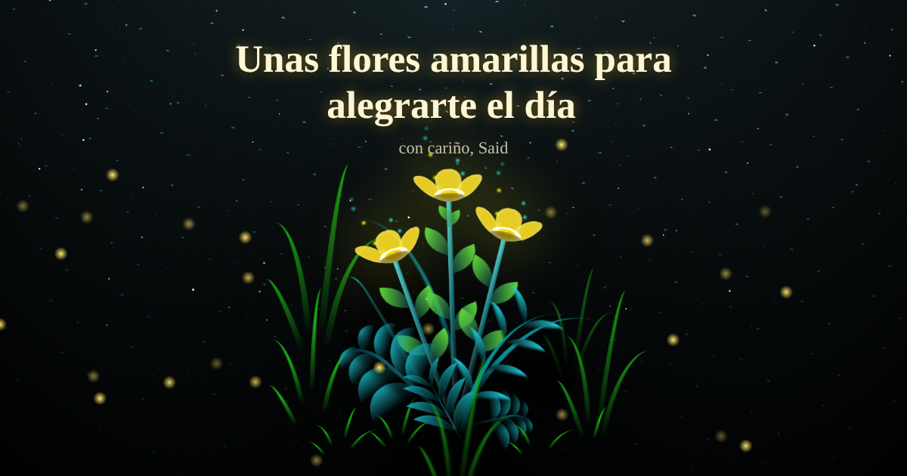

# Flores amarillas

Un ramo de flores amarillas que crece en pantalla, con una carta de entrada y un mensaje que se escribe solo. Se manda por enlace y cada quien le pone su nombre y su mensaje.



**Verlo en vivo:** https://said1ojeda.github.io/FloresAmarillas/

## Qué tiene

- Carta de entrada con el nombre de quien la recibe, las flores empiezan a crecer al abrirla
- Mensaje con efecto de máquina de escribir y firma
- Cielo de noche con estrellas que titilan, estrellas fugaces y luciérnagas
- Pétalos que salen al tocar la pantalla
- Botón para volver a florecer el ramo desde cero
- Música de cajita hecha con Web Audio, sin archivos de audio, con botón para quitarla
- Panel para crear tu propio ramo y copiar o compartir el enlace
- Se acomoda a cualquier pantalla, el ramo se achica si el mensaje es largo
- Respeta la opción de reducir movimiento del sistema

## Cómo mandarlo personalizado

Se usan tres datos en el enlace, todos opcionales:

| Dato | Para qué | Máximo |
| --- | --- | --- |
| `para` | nombre de quien lo recibe | 40 letras |
| `de` | tu nombre, sale en la firma | 40 letras |
| `mensaje` | el texto que se escribe | 160 letras |

Ejemplo:

```
https://said1ojeda.github.io/FloresAmarillas/?para=Ana&de=Said&mensaje=Feliz%20cumple
```

O más fácil, abre la página y toca el botón del avioncito, ahí llenas los datos y copias el enlace.

Todo lo que llega por el enlace se pone como texto, no se puede meter código por ahí.

## Correrlo en tu compu

No necesita nada, es un solo `index.html`. Lo abres en el navegador y listo.

## Créditos

El arte de las flores en CSS viene de una pieza publicada en CodePen. Sobre eso se agregó la carta, el mensaje, el cielo, la música y el panel para compartir.

## Licencia

[MIT](LICENSE)
